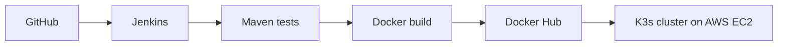

# Rakesh Kumar

### Junior DevOps Engineer | AWS · Jenkins · Docker · Kubernetes · Terraform

DevOps engineer with about a year of hands-on experience running client applications on AWS EC2, plus end-to-end projects built during AWS & DevOps training. Based in Bengaluru, available to join immediately.

## Technical Skills

| Area | Tools |
|---|---|
| Cloud | AWS (EC2, S3, VPC, IAM, RDS, CloudWatch) |
| CI/CD | Jenkins, Maven, Git, GitHub |
| Containers | Docker, Kubernetes (K3s) |
| Infrastructure as Code | Terraform |
| Monitoring | CloudWatch, Grafana |
| OS & Scripting | Linux (Ubuntu), Bash, Python |

## Work Experience

**Cloud & DevOps Support, Remedo (Jan 2025 – May 2026)**
- Deployed and maintained client applications on Linux-based AWS EC2 servers
- Containerised applications with Docker and supported Kubernetes workloads
- Ran Jenkins CI/CD pipelines for application deployments
- Monitored servers using CloudWatch and Grafana

## Projects

### 1. End-to-End CI/CD Pipeline: Jenkins + Docker + K3s on AWS EC2
A Jenkins pipeline that tests a Java 21 app with Maven, builds a Docker image, pushes it to Docker Hub and deploys it to a 3-node K3s cluster on AWS EC2.

- 3-node K3s cluster (1 master, 2 workers) inside a VPC
- 2 replicas with readiness/liveness probes, resource limits and non-root user
- Credentials stored in Jenkins Credentials, nothing hardcoded

[View Repository](https://github.com/rakesh-cloudops/ci-cd-jenkins-k3s-project)

### 2. Infrastructure as Code: Terraform on AWS
EC2 instance and security group (SSH and HTTP rules) provisioned in ap-south-1 using Terraform (init, validate, plan, apply, destroy).

[View Repository](https://github.com/rakesh-cloudops/terraform-practical)

### 3. Multi-Tier App on Kubernetes (Go + Redis)
A Go guestbook app with a Redis master-replica backend, deployed with separate Kubernetes manifests per tier and exposed through a LoadBalancer Service.

[View Repository](https://github.com/rakesh-cloudops/guestbook-go-practice)

### 4. Java Web App: Maven + Apache Tomcat
A JSP application packaged as a WAR file with Maven and deployed on Apache Tomcat, set up for a Jenkins build-and-deploy workflow.

[View Repository](https://github.com/rakesh-cloudops/jenkins-maven-tomcat-demo)

### Other Repositories
- [Jenkins Pipeline Demo](https://github.com/rakesh-cloudops/jenkins-pipeline-demo): Jenkins pipeline basics with GitHub integration
- [Jenkins CI/CD Website](https://github.com/rakesh-cloudops/jenkins-cicd-website): DevOps-themed static website (HTML, CSS, JavaScript)

## Certifications & Training
- AWS Cloud & DevOps Training, Trishana Technologies, Bangalore
- AWS Certified Cloud Practitioner (in progress)

## Contact
- LinkedIn: [linkedin.com/in/rakesh-kumar-b67b7919b](https://www.linkedin.com/in/rakesh-kumar-b67b7919b)
- Email: rakeshrkt4399@gmail.com
